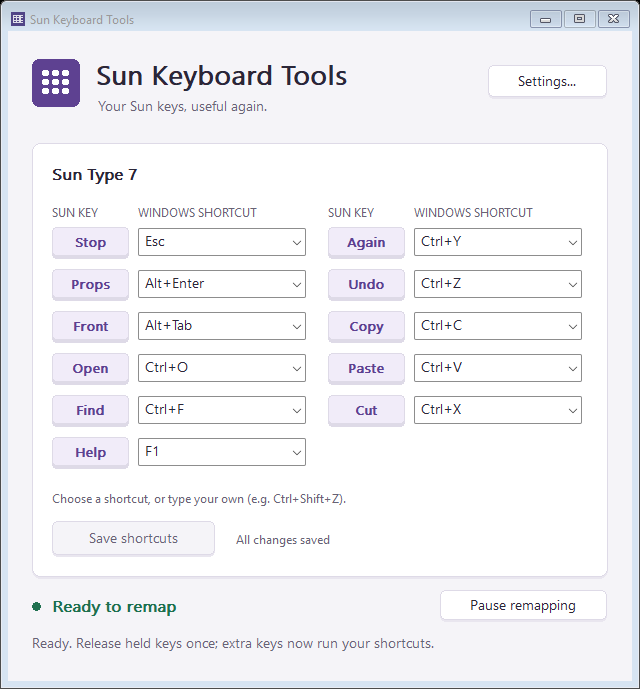
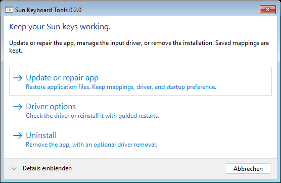
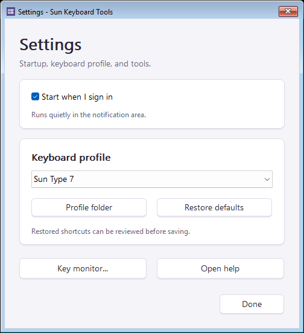
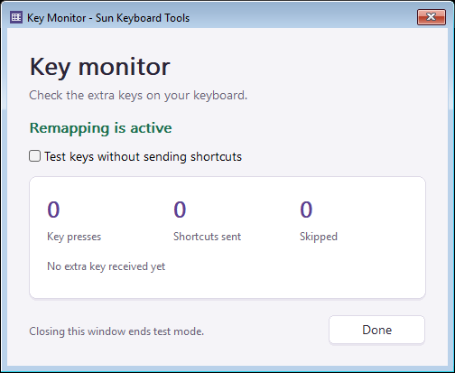

# Sun Keyboard Tools

[](https://github.com/Nnamllit1/sun-keyboard-tools/actions/workflows/build.yml)
[](https://github.com/Nnamllit1/sun-keyboard-tools/releases/latest)

**Bring the extra keys on your Sun Type 7 keyboard back to life on Windows.**

A small C++20 tray application turns Copy, Paste, Undo, Cut, Find, and the other
Sun keys into familiar shortcuts. It includes editable keyboard profiles, a key
monitor, and automatic startup. The offline installer bundles the official signed
USBPcap driver and its matching source archive.

> **Preview release.** The app and installer build and the decoder tests pass.
> Copy, Paste, and Undo have been verified on a physical Type 7, along with
> automatic startup after a Windows restart. The other default keys and hotplug
> behavior have not yet been tested on hardware. See [validation](docs/VALIDATION.md).
> USBPcap 1.5.4.0 has an [unresolved Windows 11 crash report](https://github.com/desowin/usbpcap/issues/146).
> The original application and setup executable are unsigned; the bundled
> USBPcap installer has an upstream Authenticode signature.



## Install and use

1. [Download the latest Windows installer](https://github.com/Nnamllit1/sun-keyboard-tools/releases/latest), then double-click `SunKeyboardTools-Setup-0.4.0-x64.exe`.
2. Review the setup summary and choose **Install**. Administrator access is needed.
3. Restart Windows if setup installed USBPcap for the first time. Setup never
   restarts your computer automatically.
4. Open **Sun Keyboard Tools** from Start, or click its notification-area icon.
   It starts automatically at subsequent sign-ins.
5. Release held keys once, or tap and release an ordinary key, then try Copy and
   Paste in a text editor.

Installation, repair, driver maintenance, and uninstall use graphical windows.
You do not need CMD or PowerShell to use the app.



The app targets Windows 10/11 x64 and an administrator account. USBPcap must be
accepted by the current Windows security policy; do not disable security features
if it is blocked. Windows 11 driver compatibility is experimental. There is one
included profile, for the Sun Type 7 USB keyboard (`0430:00a2`). Other models are
not claimed as tested. Connect only one keyboard matching the selected profile.

| Sun key | Default shortcut | Typical action |
| --- | --- | --- |
| Stop | Esc | Cancel |
| Again | Ctrl+Y | Redo |
| Props | Alt+Enter | Properties |
| Undo | Ctrl+Z | Undo |
| Front | Alt+Tab | Switch window |
| Copy | Ctrl+C | Copy |
| Open | Ctrl+O | Open |
| Paste | Ctrl+V | Paste |
| Find | Ctrl+F | Find |
| Cut | Ctrl+X | Cut |
| Help | F1 | Help |

These are global shortcuts; their effects depend on the focused application.
Choose or type a different shortcut in the main window and click **Save shortcuts**.
For example, use `Ctrl+Shift+Z` for redo in an application that expects it.
`Disabled` leaves an extra key without an assigned action.
The save indicator shows pending edits; **Save shortcuts** becomes available when
you change a shortcut. The compact status line shows the current capture mode.
Longer profiles and shorter displays can scroll to keep every control reachable.

**Settings** opens a separate window for startup, profile selection, defaults,
and help. **Key monitor** opens from Settings or the tray menu; it shows counts
and the last extra key. Opening it leaves remapping active. Select **Test keys
without sending shortcuts** to disable actions while testing. Closing Key Monitor
ends test mode.

**Pause remapping** stops capture temporarily. Closing the main window closes its
utility windows, ends test mode, and leaves the app in the tray. Right-click the
tray icon and choose **Exit** to stop it completely. A new launch resumes normal
remapping.





## Automatic startup

Setup registers a Task Scheduler logon task for the installing account, running
with highest available privileges. Toggle **Start when I sign in**
under **Settings** to remove or recreate it. Interactive remapping starts after sign-in;
it does not run on the lock/login screen or require a new custom driver.

If UAC is answered with a different account's credentials, profiles and startup
belong to that administrator account. Standard-user installation with a separate
privileged capture service is not implemented.

## Profiles and extending support

Settings and profiles are stored in `%LOCALAPPDATA%\SunKeyboardTools`. Use the
**Settings > Profile folder** button to find them. Bundled defaults are copied only when
missing, so upgrades keep existing mappings. Restart after adding a profile.

See [the profile format](docs/PROFILES.md) for USB IDs, endpoint/report layout,
HID usages, shortcut syntax, and the evidence needed for another model.
Array-style HID reports are configurable; bitfield or proprietary report formats
need a C++ decoder extension. USBPcap observes traffic and cannot suppress keys
Windows already handles, so these profiles are intended for ignored extra keys.

## How it works

The original remapping application stays in user space. USBPcap is an existing
open-source USB class filter driver. We bundle its unmodified official 1.5.4.0
installer, complete matching source archive, and GPL/BSD notices. There is no
custom kernel driver to build or sign.

The backend discovers the matching keyboard through USB hub topology, restricts
capture to its device address, validates reports, and uses `SendInput` for each
new extra-key press. It does not save USB captures, typed text, or clipboard data,
and makes no network requests. The USBPcap driver itself attaches system-wide.
See [architecture and verification](docs/ARCHITECTURE.md) for details and limits.

## Troubleshooting

- **USBPcap is not active:** restart after the first driver installation. Setup
  reuses an existing USBPcap installation; it does not repeatedly reinstall it.
- **No matching keyboard / capture cannot open:** check the selected profile and
  USB connection. Close Wireshark or USBPcapCMD if it is using that controller.
- **First press does nothing:** release and retry. The initial valid report sets
  held-key state after startup, profile changes, or reconnection.
- **Shortcut skipped:** release held modifiers and the target shortcut key.
  Conflicting modifiers are skipped to avoid sending an unintended shortcut.
- **No effect in one application:** check that application's shortcuts. Secure
  desktops and some programs do not accept injected input.

The installed **Help** button opens an offline guide. Developers can run
`sun-key-monitor PROFILE.ini 60 OUTPUT.txt` as administrator for a bounded,
non-injecting report/count check. Exit the tray app first. No ordinary keys or
raw USB payloads are logged.

## Repair, update, or reinstall the driver

Open **Sun Keyboard Tools Setup** from Start, or run the downloaded installer.

- **Update or repair app** restores application files and shortcuts while keeping
  your saved profiles, existing driver, and automatic-startup preference.
- **Driver options** shows whether USBPcap is active, absent, incomplete, or
  waiting for a restart. **Reinstall driver** removes USBPcap using its signed
  uninstaller. Restart when ready; setup reopens after sign-in to offer
  **Install driver**. A second restart activates the new driver.
- **Uninstall** keeps saved profiles. An unchecked-by-default option also removes
  USBPcap; this affects Wireshark and any other program using that shared driver.

Setup closes the remapper before changing its files. Unsaved shortcut edits must
be resolved first. Progress and completion are shown in windows, and setup never
restarts Windows automatically. A custom/broken USBPcap installation can be
managed using the **Open Windows Installed apps** button.

## Build (developers)

Requires Visual Studio 2022 with Desktop development with C++, a Windows SDK,
and CMake 3.24 or newer. No third-party runtime libraries are required.

```powershell
cmake -S . -B build -G "Visual Studio 17 2022" -A x64
cmake --build build --config Release
ctest --test-dir build -C Release --output-on-failure
```

Run `build\Release\sun-keyboard-tools.exe` elevated once USBPcap is installed.
The `profiles` directory and `README.html` are copied beside the executable.
The bundled icon is original code-drawn artwork; `tools/make_icon.py` regenerates
it if desired. The checked-in ICO allows builds without Python.

To build the offline installer, including pinned upstream dependencies:

```powershell
powershell -ExecutionPolicy Bypass -File tools/package.ps1
```

Pass `-CMake "C:\path\to\cmake.exe"` if CMake is not on PATH. The script downloads
the two exact upstream release assets, verifies SHA-256 and the driver's installer
signature, builds, tests, and writes the installer and checksum to `out`.
CMake can also build setup directly with `-DSUN_BUILD_SETUP=ON` once the verified
files are in `.local/dependencies` (or `-DSUN_DEPS_DIR=...`). Packaging does not
install the driver. `Setup.exe --extract NEW_DIRECTORY` verifies payload extraction
without installing anything. The executable's actual name includes its product
name/version; use that path in place of `Setup.exe`.

## Uninstall

Use Windows **Settings → Apps → Installed apps → Sun Keyboard Tools**. Uninstall
removes the app and the invoking account's startup task. Other users should turn
off their own startup tasks first. Saved profiles remain. Select **Also remove
USBPcap** only if no other program needs the shared driver, then restart when
ready. Reinstalling the app immediately is supported: cleanup of the old
uninstaller never targets the new installation.

## Builds and releases

Every push to `main` and pull request builds, tests, and packages the Windows
installer in [GitHub Actions](https://github.com/Nnamllit1/sun-keyboard-tools/actions).
Each successful run offers a downloadable `windows-x64` artifact. Version tags
such as `v0.2.0` publish the verified installer and SHA-256 checksum to
[Releases](https://github.com/Nnamllit1/sun-keyboard-tools/releases).

See [the maintainer release guide](docs/RELEASING.md) for versioning and retries.

## Project metadata and licensing

Suggested repository description and search topics are provided in
[repository-metadata.json](.github/repository-metadata.json).

**A license for the original project code has not yet been selected.** See
[COPYRIGHT.txt](COPYRIGHT.txt). USBPcap retains its own upstream licenses; see
[third-party notices](third-party/NOTICE.txt). Do not remove its matching source
archive or notices from redistributed packages. This project is not affiliated
with Sun Microsystems, Oracle, Microsoft, or the USBPcap project.
